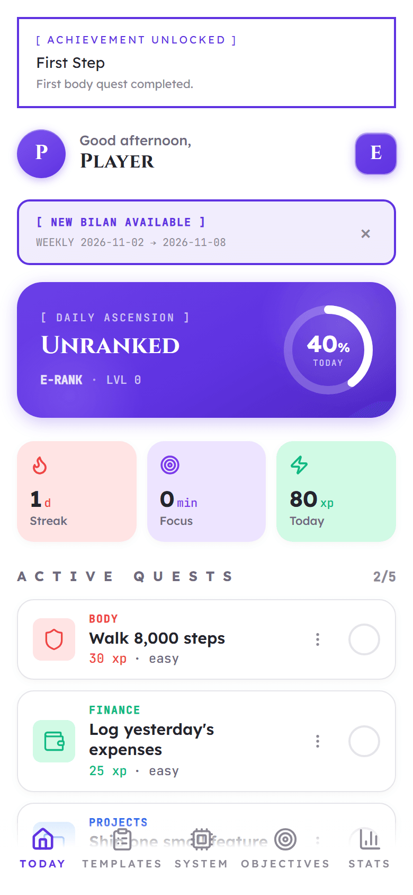
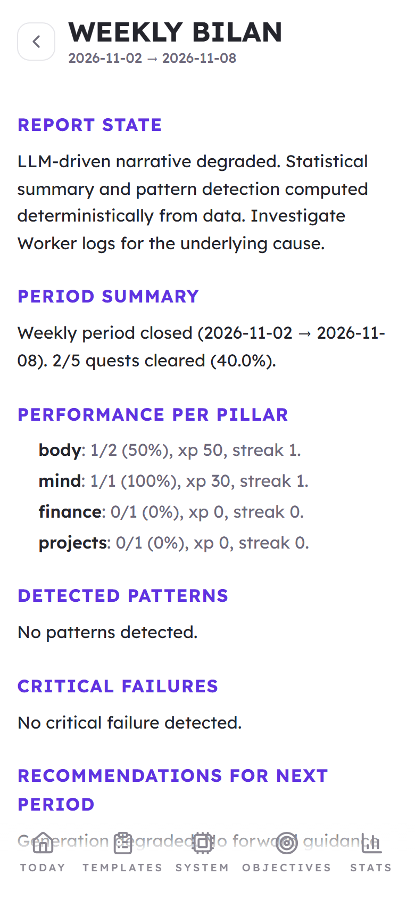

# OttoLeveling

OttoLeveling turns personal goals into daily quests across four pillars: body, mind, finance and projects. An agent called The System writes the quests and periodic reports in the voice of a game interface; plain TypeScript decides everything that is counted. It is a single-user PWA that runs entirely on Cloudflare. I built it for myself and I use it every day.

<table>
  <tr>
    <td align="center">
      <br />
      <sub>Local build, fictional player</sub>
    </td>
    <td align="center">
      <br />
      <sub>Local build, fictional player</sub>
    </td>
  </tr>
</table>

The name is a nod to Solo Leveling.

## What the code decides, what the LLM writes

**Code decides**, with unit and integration tests:

- XP and levels (`level = floor(sqrt(xp / 100))`), penalties per difficulty
- streaks (a day with no assigned quest does not break one)
- template progression, ranks and titles, achievements
- arc lifecycle (multi-day quest chains): caps, expiry, rewards
- pattern detection and their confidence scores
- report statistics
- auto-completion of quests from external metrics (steps, saved episodes)

**The LLM writes**: the choice and wording of each day's quests, a short reasoning line, and the narrative of weekly, monthly and yearly reports. The quest prompt is built from about twenty context sections (objectives, levels, recent history, check-ins, health metrics, active projects) and carries eleven numbered rules.

**Guardrails** between the two:

- Every LLM response is parsed with Zod. A failed call or parse falls back to four observational quests that prescribe no movement.
- A post-generation validator rereads each quest and replaces any that matches a forbidden pattern from the player profile or a template's contraindications. Matching is lexical; see Known limits.

## Run it locally, without any key

Requirements: Node 20 or later, pnpm 10.

```bash
pnpm install
cp apps/api/.dev.vars.example apps/api/.dev.vars
cp apps/web/.env.example apps/web/.env.local
pnpm db:migrate:local
pnpm dev:api        # http://localhost:8787
pnpm dev:web        # http://localhost:5173, in a second terminal
```

The API listens on port 8787 by default. If 8787 is already taken, wrangler picks the next free port without warning; the last line of `pnpm dev:api` shows the real address (`Ready on http://127.0.0.1:<port>`). In that case set `PUBLIC_API_BASE` in `apps/web/.env.local` to that address and restart `pnpm dev:web`.

The Today screen starts empty. Generate the day's quests from System, then Admin.

What you get:

- a fictional player with eight objectives and seven quest templates (`migrations/0002_seed_data.sql`);
- `LLM_PROVIDER=mock`: generation returns a fixed sample batch, reports use their deterministic fallback;
- `PUSH_PROVIDER=mock`: push notifications are recorded, not sent;
- Google Health and Spotify show as disconnected;
- the web app authenticates with the development token from `.env.local`.

The queue consumer is not needed locally: regenerating today's quests from System, then Admin, runs inline.

To use a real model, set `LLM_PROVIDER=groq` and `GROQ_API_KEY` in `apps/api/.dev.vars`.

Other commands:

```bash
pnpm test           # API (Node + workerd) and web tests, no secrets needed
pnpm typecheck
pnpm lint
pnpm build
```

## Configuration

API variables (`apps/api/wrangler.toml`, `.dev.vars` locally, `wrangler secret put --env production` for secrets):

| Variable                                                                                    | Purpose                                                                                                                                                                                                                                   |
| ------------------------------------------------------------------------------------------- | ----------------------------------------------------------------------------------------------------------------------------------------------------------------------------------------------------------------------------------------- |
| `ENV`                                                                                       | `development` locally, `production` in the production environment. Production refuses the development token.                                                                                                                              |
| `DEV_TOKEN`                                                                                 | Shared token for local development and tests.                                                                                                                                                                                             |
| `LLM_PROVIDER`, `GROQ_API_KEY`, `LLM_MODEL`                                                 | `mock` or `groq`.                                                                                                                                                                                                                         |
| `PLAYER_NAME`                                                                               | Name used in the prompts. Defaults to `Player`.                                                                                                                                                                                           |
| `PLAYER_PROFILE`                                                                            | Free text about the player, including physical constraints. Its `Forbidden:` list and `(no X)` asides feed the validator. A conservative default is used when unset. Keep it a secret in production: it usually holds health information. |
| `DAY_JOB_EXCLUSIONS`                                                                        | Comma-separated domains the agent must never turn into quests.                                                                                                                                                                            |
| `WEB_ORIGIN`                                                                                | Allowed CORS origin(s), and the redirect target after OAuth.                                                                                                                                                                              |
| `ENCRYPTION_KEY`                                                                            | 32 random bytes, base64. Encrypts OAuth tokens. `openssl rand -base64 32`                                                                                                                                                                 |
| `PUSH_PROVIDER`, `VAPID_PUBLIC_KEY`, `VAPID_PRIVATE_KEY`, `VAPID_SUBJECT`                   | Web Push.                                                                                                                                                                                                                                 |
| `GOOGLE_HEALTH_*`, `SPOTIFY_*`                                                              | OAuth client and redirect URI per provider.                                                                                                                                                                                               |
| `CLOUDFLARE_ACCESS_TEAM_DOMAIN`, `CLOUDFLARE_ACCESS_AUD`, `CLOUDFLARE_ACCESS_ALLOWED_EMAIL` | Production authentication.                                                                                                                                                                                                                |

Web variables (`apps/web/.env.local` locally, the Pages project's environment variables in production; read at runtime): `PUBLIC_API_BASE`, `PUBLIC_PLAYER_NAME`, and `PUBLIC_DEV_TOKEN` (used only under `vite dev`).

## Deploy

1. Create the resources: a D1 database `ottoleveling`, a KV namespace, and four queues (`ottoleveling-llm-jobs`, `ottoleveling-events` and their `-dlq` variants). Workflows and the Analytics Engine dataset are created on first deploy.
2. Replace every `<your-...>` placeholder in `apps/api/wrangler.toml` and `apps/queue-consumer/wrangler.toml`. Production settings live under `[env.production]`.
3. `pnpm db:migrate:remote`
4. Set the secrets with `wrangler secret put <NAME> --env production` from `apps/api`: `GROQ_API_KEY`, `ENCRYPTION_KEY`, `VAPID_PRIVATE_KEY`, `GOOGLE_HEALTH_CLIENT_SECRET`, `SPOTIFY_CLIENT_SECRET`, `PLAYER_PROFILE`, `DAY_JOB_EXCLUSIONS`. Pipe values with `printf '%s'`: a trailing newline breaks token comparisons.
5. `pnpm deploy:api`, then `pnpm deploy:consumer`.
6. Set `PUBLIC_API_BASE` (and optionally `PUBLIC_PLAYER_NAME`) in the Pages project's environment variables, then `pnpm --filter ottoleveling-web build` and `pnpm deploy:web`.
7. Put the Pages domain behind a Cloudflare Access application restricted to your email. Add bypass rules for `/service-worker.js`, `/manifest.webmanifest`, `/icons/*` and `/_app/*`, otherwise the service worker cannot register.

## Integrations

**Google Health.** OAuth with PKCE, tokens encrypted at rest. A daily sync stores steps, average heart rate, resting heart rate, HRV and sleep minutes for the previous UTC day. The metrics feed the prompt and the calibration rules: declining HRV or short sleep caps body quests at easy difficulty. In Google's testing mode a refresh token expires after seven days without use; the daily sync keeps it alive.

**Spotify: saves, not listens.** Spotify's listening history excludes podcast episodes and audiobook chapters, so the integration cannot see what was listened to. It diffs the saved library each day and records new saves. A saved episode counts as intent to learn, never as proof of listening, and every place that shows the data says so. Per-show filters decide which shows count toward the mind pillar.

**Web Push.** VAPID through Workers' Web Crypto, one notification for the morning batch and one for the weekly report.

## Tests

- API: unit tests in Node, integration tests inside workerd through `@cloudflare/vitest-pool-workers`, with D1, KV, Durable Object and Workflow bindings simulated by Miniflare. The LLM and push providers are mocked.
- Web: copy modules, Markdown sanitization and component logic.

Prompt tests check that each rule and placeholder is present in the prompt text. They cannot show that the model obeys a rule. The validator is tested against deliberately bad model output.

## Known limits

- **Single user.** One Durable Object instance, no users table. Authentication is a Cloudflare Access email allow-list.
- **Confidence scores are heuristics.** They are weighted sums with hand-picked weights. They order patterns; they are not calibrated probabilities.
- **The validator is lexical.** It catches listed words and their plurals, not paraphrases. It is a safety net under the prompt rules, not a medical guarantee.
- **The orchestration is oversized on purpose.** A Durable Object alarm, a Workflow, two queues, a separate consumer Worker and an Analytics Engine dataset handle one LLM call a day. A single alarm with `ctx.waitUntil` would do. They are there to learn those primitives.
- **`apps/api/src/index.ts` is too long.** About 1,900 lines hold the Hono app and the whole `SystemAgent` class. It should be split by responsibility.
- **Unprocessed report messages.** Each Sunday the daily Workflow sends a `generate_bilan_weekly` message that the consumer acknowledges without processing. The weekly report is produced by the Durable Object alarm instead.
- **Token budget.** The quest prompt is about 8,400 input tokens, close to the 12,000 tokens per minute of Groq's free tier.

## Documentation

- `docs/ARCHITECTURE.md`: components, daily flow, data model, auth.
- `docs/decisions.md`: the reasons behind six design choices.
- `prompts/`: the two prompts, as sent to the model.

## License

MIT.
